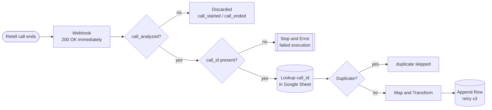
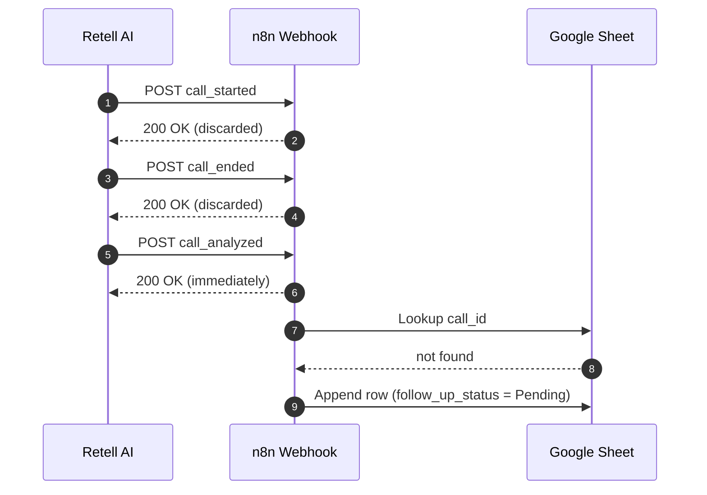

<div align="center">


<br/>


<br/>

[](https://www.loom.com/share/75985b0632364804840d82b19f987200)
[](docs/NovaNest_Webhook_Pipeline_Project_Summary.pdf)
[](workflow/novanest-call-log.json)
[](docs/test-results.md)
[](docs/screenshots)


</div>

<a id="toc"></a>

## 📚 Contents

[Overview](#overview) · [Architecture](#architecture) · [Features](#features) · [Event routing](#routing) · [Field mapping](#mapping) · [Quick start](#quickstart) · [Run the tests](#tests) · [Results](#results) · [Screenshots](#screenshots) · [Error handling](#errors) · [Assumptions and limitations](#limits) · [Enhancements](#enhancements) · [Repo layout](#layout)

<a id="overview"></a>

## 🎯 Overview

**NovaNest Real Estate** takes consultation bookings through a Retell AI voice agent. This project turns every finished call into a single, structured row in a Google Sheet, so the sales team can start follow-up without listening to a recording.

| | |
|---|---|
| **Trigger** | Retell AI webhook (agent-level) |
| **Source of record** | `call_analyzed` event (carries summary and Post-Call Analysis fields) |
| **Automation** | n8n Cloud workflow |
| **Destination** | Google Sheet tab `NovaNest Call Log` (12 columns) |
| **Guarantees** | 200 OK first, no duplicates, no silent blanks, failures stay visible |

<a id="architecture"></a>

## 🏗️ Architecture



<details>
<summary><b>Event timeline of one call (click to expand)</b></summary>



</details>

<a id="features"></a>

## ✨ Features

| | Feature | How it works |
|---|---|---|
| ⚡ | **Response-first** | The webhook returns 200 OK immediately; sheet work happens after, so Retell never retries because of a slow write. |
| 🧭 | **Event filter** | Only `call_analyzed` is written. `call_started` and `call_ended` are acknowledged and discarded. |
| 🔑 | **Idempotency** | `call_id` is looked up in the sheet before writing. A repeat delivery goes to "duplicate skipped". |
| 🧮 | **Transformations** | Date `YYYY-MM-DD`, time `HH:MM CT`, `duration_ms / 1000`, first and last name joined. |
| 🩹 | **No silent blanks** | Missing analysis fields become `N/A`; an invalid or expired recording URL becomes `URL expired`. |
| 🔁 | **Retries** | The Append Row node retries on failure (3 tries, 2 retries). |
| 🚨 | **Error visibility** | A payload without `call.call_id` ends in a Stop and Error node, shown as a failed execution. |

<a id="routing"></a>

## 🧭 Event routing

| Event | Action |
|---|---|
| `call_started` | Acknowledge 200, discard |
| `call_ended` | Acknowledge 200, discard |
| `call_analyzed` | Check `call_id` → dedupe → map → append row |
| anything else | Acknowledge 200, discard |

<a id="mapping"></a>

## 🗺️ Field mapping

<details>
<summary><b>Show the 12-column mapping (click to expand)</b></summary>

<br/>

| Column | JSON path (under `call`) | Transformation |
|---|---|---|
| `call_id` | `call_id` | Idempotency key |
| `call_date` | `start_timestamp` | `YYYY-MM-DD`, America/Chicago |
| `call_time` | `start_timestamp` | `HH:MM CT` |
| `duration_seconds` | `duration_ms` | Divide by 1000, round |
| `call_status` | `call_status` | As received |
| `caller_name` | `call_analysis.caller_first_name` + `caller_last_name` | Joined with a space |
| `caller_phone` | `call_analysis.caller_phone` | `N/A` if null |
| `caller_email` | `call_analysis.caller_email` | `N/A` if null |
| `qualification_status` | `call_analysis.qualification_status` | Hot / Warm / Cold / Disqualified, `N/A` if null |
| `call_summary` | `call_analysis.call_summary` | `N/A` if null |
| `recording_url` | `recording_url` | Valid https URL kept, otherwise `URL expired` |
| `follow_up_status` | (default) | Always `Pending` |

Custom Post-Call Analysis fields are read from `call.call_analysis` merged with `call.call_analysis.custom_analysis_data`.

Full details: [`docs/field-mapping.md`](docs/field-mapping.md)

</details>

<a id="quickstart"></a>

## 🚀 Quick start

1. **Sheet.** Create a Google Sheet with a tab named `NovaNest Call Log` and paste the headers from [`sheet-headers.csv`](sheet-headers.csv) into row 1.
2. **Import.** In n8n choose **Import from file** and select [`workflow/novanest-call-log.json`](workflow/novanest-call-log.json).
3. **Connect.** Open the two Google Sheets nodes (*Lookup call_id in Sheet* and *Append Row*), pick your own Google credential, document and sheet.
4. **Activate.** Publish the workflow and copy the **Production** webhook URL.
5. **Register.** In Retell open the agent, go to *Webhook settings*, paste the URL into **Agent Level Webhook URL**, and enable `call_started`, `call_ended`, `call_analyzed`.
6. **Check Post-Call Analysis.** It must be ON with the caller fields and `qualification_status`.
7. **Test.** Run the tests below, then make a call from the Retell test console.

<a id="tests"></a>

## 🧪 Run the tests

**Windows PowerShell**

```powershell
$env:WEBHOOK_URL = "https://<your-n8n>/webhook/retell-novanest"
.\tests\run_tests.ps1
```

**Bash**

```bash
WEBHOOK_URL="https://<your-n8n>/webhook/retell-novanest" ./tests/run_tests.sh
```

Single payload:

```powershell
curl.exe -X POST "https://<your-n8n>/webhook/retell-novanest" -H "Content-Type: application/json" -d "@tests/payloads/01_valid_call_analyzed.json"
```

Wait a few seconds between sends, because many writes to Google Sheets within one or two seconds can overwrite each other.

<a id="results"></a>

## ✅ Test results

Method: one full end-to-end real Retell web call, plus payload-injection tests with `curl.exe` (files in [`tests/payloads`](tests/payloads)). Additional real calls were skipped to save call credits.

| ID | Test | Result |
|---|---|---|
| TC-001 | `call_analyzed` creates a row | ✅ Pass |
| TC-002 | `call_started` / `call_ended` discarded | ✅ Pass |
| TC-003 | Duplicate prevention | ✅ Pass |
| TC-004 | Field mapping accuracy | ✅ Pass |
| TC-005 | Recording URL expiry (`URL expired`) | ✅ Pass |
| TC-006 | Missing `call_analysis` gives `N/A` | ✅ Pass |
| TC-007 | 200 OK within 10 seconds | ✅ Pass |
| TC-008 | Distinct rows per call | ✅ Pass |
| TC-009 | `follow_up_status` = `Pending` | ✅ Pass |
| TC-010 | Failed execution visible | ✅ Pass |

Evidence per test: [`docs/test-results.md`](docs/test-results.md)

<a id="screenshots"></a>

## 🖼️ Screenshots

<table>
  <tr>
    <td align="center" width="50%"><br/><sub><b>Workflow canvas</b></sub></td>
    <td align="center" width="50%"><br/><sub><b>Real call: green end to end</b></sub></td>
  </tr>
  <tr>
    <td align="center"><br/><sub><b>Mapped output of the real call</b></sub></td>
    <td align="center"><br/><sub><b>Google Sheet with the real call row</b></sub></td>
  </tr>
  <tr>
    <td align="center"><br/><sub><b>Duplicate skipped</b></sub></td>
    <td align="center"><br/><sub><b>Failed execution is visible</b></sub></td>
  </tr>
  <tr>
    <td align="center"><br/><sub><b>Retell Post-Call Analysis fields</b></sub></td>
    <td align="center"><br/><sub><b>Retell webhook events</b></sub></td>
  </tr>
</table>

<p align="center"><a href="docs/screenshots"><b>See all 18 screenshots →</b></a></p>

<a id="errors"></a>

## 🛡️ Error handling

| Scenario | Behavior |
|---|---|
| Missing `call.call_id` | No row written; failed execution: *Payload missing call.call_id - row not written* |
| Missing or null `call_analysis` fields | Row written with `N/A` in the affected columns |
| Expired or invalid recording URL | `URL expired` placeholder |
| Sheet write fails | Retry on fail (3 tries), then a failed execution in n8n |
| Duplicate delivery | "duplicate skipped" path, no write |

<a id="limits"></a>

## 📝 Assumptions and limitations

**Assumptions**
- Post-Call Analysis from the earlier topics is already configured on the agent.
- Times are shown in Central Time (America/Chicago).
- n8n Cloud provides the public HTTPS webhook URL.

**Limitations**
- `recording_url` is validated but not re-uploaded, so the link expires after about 10 minutes.
- Very rapid concurrent deliveries within a few seconds can overwrite rows in Google Sheets (seen in a burst test); real calls arrive minutes apart. Lookup followed by append is not atomic.
- In the real call, the Topic 7 `create_booking_request` function returned an error. This is outside this topic and did not affect the pipeline, which still logged the call correctly.

<a id="enhancements"></a>

## 🔭 Enhancements

- [ ] Download the recording immediately and store it permanently (Google Drive or S3)
- [ ] Verify the Retell webhook signature
- [ ] Slack or email alert for Hot leads
- [ ] Dead-letter tab and a global n8n error workflow
- [ ] CRM or Airtable with a `call_id` upsert for atomic idempotency

<a id="layout"></a>

## 📁 Repo layout

```text
novanest-webhook-pipeline/
├── assets/                  banner, tagline, divider, footer (animated SVG)
├── workflow/
│   └── novanest-call-log.json
├── tests/
│   ├── payloads/            8 test payloads
│   ├── run_tests.ps1        Windows PowerShell runner
│   └── run_tests.sh         Bash runner
├── docs/
│   ├── field-mapping.md
│   ├── test-results.md
│   ├── demo-video-script.md
│   ├── NovaNest_Webhook_Pipeline_Project_Summary.pdf
│   └── screenshots/         18 evidence images
├── sheet-headers.csv
└── README.md
```

<br/>

<div align="center">


**Built by [Shaik Shahid](https://github.com/shaikshahid777)** for Retell AI Lesson 5: Webhooks, Post-Call Events and Automation Pipelines


</div>
